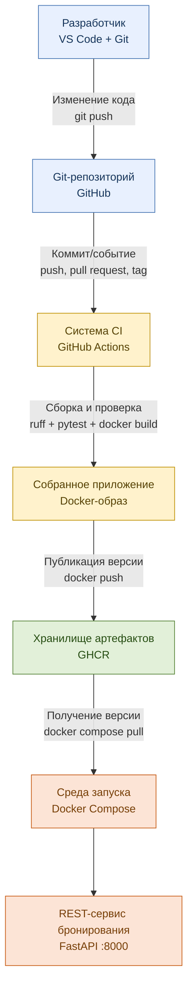
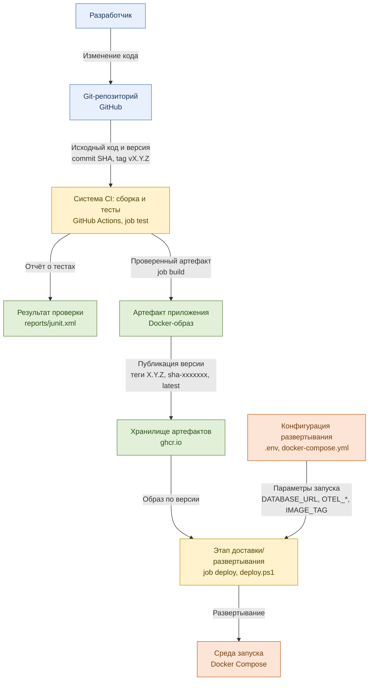
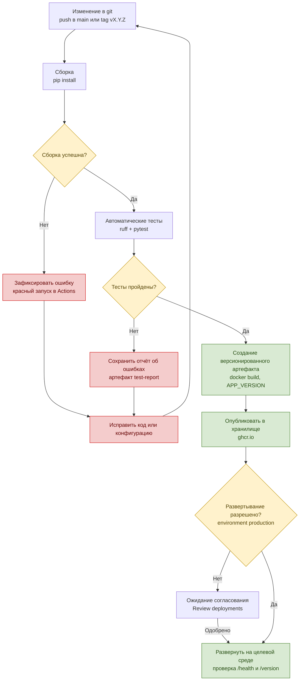
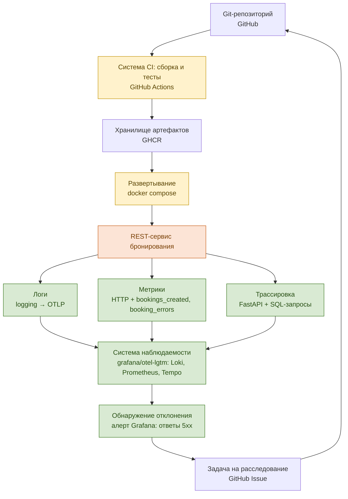
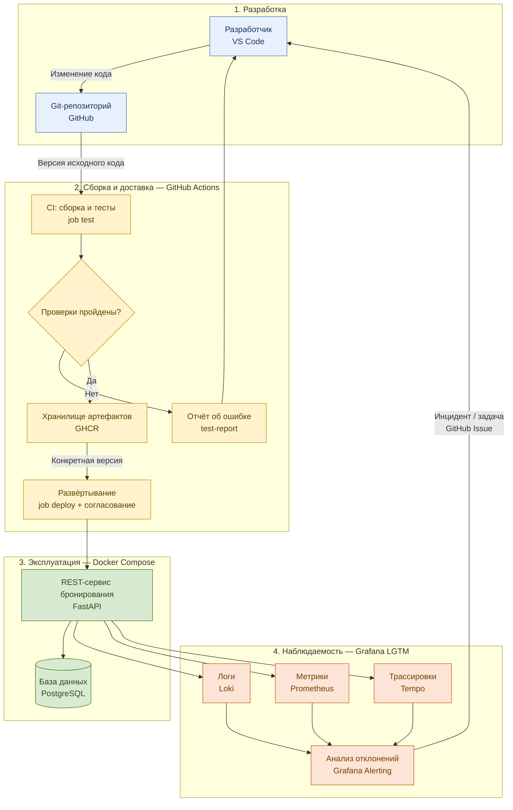

# Журнал DevOps: REST-сервис бронирования

**Автор:** <!-- ФИО, группа -->
**Репозиторий:** https://github.com/<ваш-логин>/booking-service
**Период работ:** <!-- даты -->

Журнал фиксирует, что сделано на каждом этапе, какими командами и чем это подтверждается. Строки «Результат» и скриншоты заполняются по мере выполнения. Описание компонентов — в `INFRASTRUCTURE.md`.

## Хронология

| Дата | Что сделано | Результат / ссылка |
|---|---|---|
| <!-- дд.мм --> | Установлены WSL 2, Docker Desktop, Git, Python 3.13, VS Code | `docker version`, `git --version` выполняются без ошибок |
| | Создан репозиторий на GitHub, первый push в `main` | ссылка на коммит |
| | Сервис запущен локально через Docker Compose | http://localhost:8000/docs открывается |
| | Настроен CI: тесты, сборка образа, публикация в GHCR | ссылка на зелёный запуск Actions |
| | Проверено падение CI на сломанном тесте | ссылка на красный запуск |
| | Выпущена версия `v0.1.0` | ссылка на пакет в GHCR |
| | Настроено согласование развертывания (environment `production`) | скриншот «Review deployments» |
| | Версия `0.1.0` развернута локально из GHCR | вывод `scripts/deploy.ps1` |
| | Проверены логи, метрики, трассировки в Grafana | скриншоты Explore |
| | Сработал алерт, заведена задача, выпущено исправление | ссылка на Issue и новую версию |

---

## 1. Основной поток разработки



**Как проверено**

```powershell
git add .
git commit -m "feat: booking service"
git push origin main
```

- Результат: в GitHub → Actions появился запуск **CI/CD**, jobs `test` и `build` зелёные.
- Ссылка на запуск: <!-- вставить -->
- Скриншот: <!-- вставить -->

## 2. Потоки данных и артефакты



**Как проверено**

| Поток | Подтверждение |
|---|---|
| Исходный код и версия → CI | в запуске Actions виден SHA коммита |
| CI → отчёт о тестах | в запуске скачивается артефакт `test-report` (`junit.xml`) |
| CI → проверенный артефакт → хранилище | GitHub → профиль → **Packages** → `booking-service`, теги `sha-…`, `latest` |
| Конфигурация → развертывание | `.env` с `BOOKING_IMAGE` и `IMAGE_TAG` |
| Развертывание → среда запуска | `docker compose ps` показывает `app`, `db`, `lgtm` в состоянии running |

Результат `docker compose ps`:

```text
<!-- вставить вывод -->
```

## 3. Версионирование и условия выпуска



**Как проверено**

1. Ветка «сборка/тесты не прошли»: в `tests/test_api.py` временно заменить `assert room["id"] == 1` на `assert room["id"] == 2`, закоммитить и отправить.
   - Результат: job `test` красный, job `build` не запускался, отчёт `test-report` сохранён.
   - Ссылка: <!-- вставить -->
2. Исправить тест и отправить снова — запуск зелёный.
3. Выпуск версии:
   ```powershell
   git tag v0.1.0
   git push origin v0.1.0
   ```
   - Результат: в GHCR появился тег `0.1.0`.
4. Ветка «развертывание не разрешено»: job `deploy` ждёт в статусе **Waiting**, пока не нажата кнопка **Review deployments → Approve and deploy**.
   - Скриншот ожидания: <!-- вставить -->
   - После одобрения: в Summary запуска строка «Развернута версия 0.1.0».

## 4. Наблюдаемость и обратная связь



**Как проверено**

```powershell
.\scripts\deploy.ps1 -Image ghcr.io/<ваш-логин>/booking-service -Version 0.1.0
.\scripts\traffic.ps1
.\scripts\traffic.ps1 -Errors 5
```

| Проверка | Где | Результат |
|---|---|---|
| Логи | Grafana → Explore → Loki, `{service_name="booking-service"}` | <!-- скриншот --> |
| Метрики | Explore → Prometheus, `bookings_created_total` | <!-- скриншот --> |
| Трассировка | Explore → Tempo → Search, Service Name `booking-service`, span `POST /bookings` | <!-- скриншот --> |
| Алерт | Alerting → Alert rules → «Booking: ответы 5xx» в состоянии Firing | <!-- скриншот --> |
| Задача | GitHub → Issues, шаблон «Инцидент / отклонение» | <!-- ссылка --> |

## 5. Разделение по этапам разработки и сопровождения



| Этап | Инструменты | Ответственный | Состояние |
|---|---|---|---|
| 1. Разработка | VS Code, Git, GitHub | <!-- ФИО --> | <!-- готово / в работе --> |
| 2. Сборка и доставка | GitHub Actions, Docker, GHCR, Environment `production` | | |
| 3. Эксплуатация | Docker Compose, PostgreSQL | | |
| 4. Наблюдаемость | OpenTelemetry, Grafana, Loki, Prometheus, Tempo | | |

## Проблемы и решения

| Проблема | Причина | Решение |
|---|---|---|
| <!-- пример: Docker Desktop не стартует --> | <!-- выключена виртуализация в BIOS --> | <!-- включил Intel VT-x / AMD-V --> |

## Выводы

<!-- 3–5 предложений: что получилось, что автоматизировано, что можно улучшить
     (например: развертывание на сервер вместо ноутбука, дашборд в Grafana, уведомления в Telegram). -->
