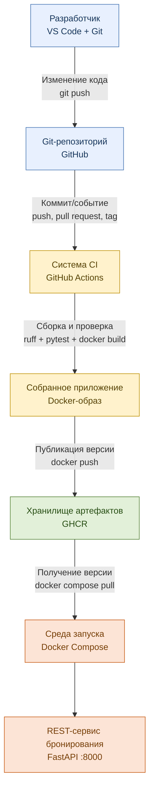
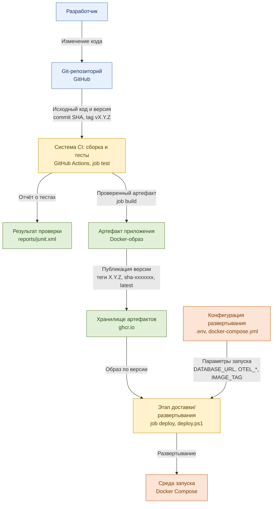
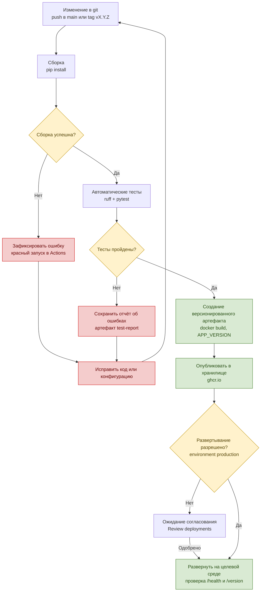
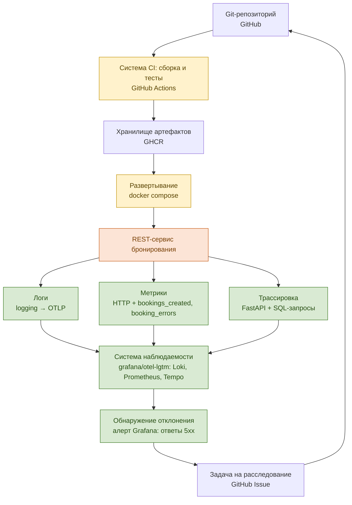
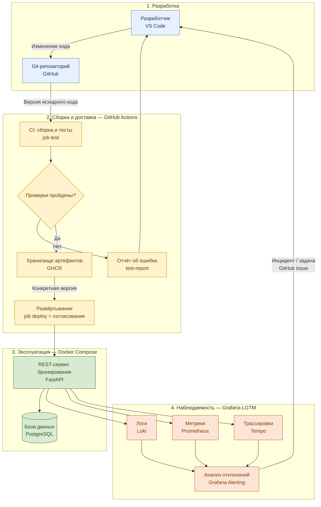

# Инфраструктура REST-сервиса бронирования

Документ описывает, из каких компонентов состоит инфраструктура, какими инструментами реализован каждый узел диаграмм и где это лежит в репозитории.

## Сводная таблица компонентов

| Узел на диаграммах | Инструмент | Где в репозитории | Адрес / порт |
|---|---|---|---|
| Разработчик | ноутбук: Windows 11 + WSL 2, VS Code, Git | — | — |
| Git-репозиторий | GitHub (`<ваш-логин>/booking-service`, ветка `main`) | весь проект | github.com |
| Система CI: сборка и тесты | GitHub Actions, job `test`: ruff + pytest | `.github/workflows/ci.yml` | вкладка **Actions** |
| Результат проверки / отчёт о тестах | JUnit XML `reports/junit.xml`, артефакт сборки `test-report` | `.github/workflows/ci.yml` | страница запуска в Actions |
| Собранное приложение / артефакт | Docker-образ | `Dockerfile` | — |
| Хранилище артефактов | GitHub Container Registry (GHCR) | job `build` | `ghcr.io/<ваш-логин>/booking-service` |
| Конфигурация развертывания | `.env` + переменные окружения в `docker-compose.yml` | `.env.example`, `docker-compose.yml` | — |
| Развертывание разрешено? / ожидание согласования | GitHub Environment `production` с обязательным одобрением | job `deploy` | Settings → Environments |
| Этап доставки / развертывания | job `deploy` (проверочный запуск образа) + `scripts/deploy.ps1` (локальная среда) | `.github/workflows/ci.yml`, `scripts/deploy.ps1` | — |
| Среда запуска | Docker Desktop + Docker Compose на ноутбуке | `docker-compose.yml` | — |
| REST-сервис бронирования | Python 3.13, FastAPI, Uvicorn | `app/` | http://localhost:8000 (`/docs`) |
| База данных | PostgreSQL 17 (в тестах — SQLite в памяти) | сервис `db` в `docker-compose.yml` | внутри сети compose, порт 5432 |
| Логи | Python `logging` → OpenTelemetry → Loki | `app/main.py` | Grafana → Explore → Loki |
| Метрики | OpenTelemetry → Prometheus | `app/main.py` | Grafana → Explore → Prometheus, http://localhost:9090 |
| Трассировки | OpenTelemetry → Tempo | автоинструментация FastAPI и SQLAlchemy | Grafana → Explore → Tempo |
| Система наблюдаемости | `grafana/otel-lgtm` (OTel Collector, Grafana, Loki, Tempo, Prometheus) | сервис `lgtm` в `docker-compose.yml` | http://localhost:3000 (admin / admin) |
| Обнаружение отклонения | правило алерта Grafana «Booking: ответы 5xx» | `observability/grafana-alerts.yaml` | Grafana → Alerting → Alert rules |
| Задача на расследование | GitHub Issues, шаблон «Инцидент / отклонение» | `.github/ISSUE_TEMPLATE/incident.md` | вкладка **Issues** |

## Основной поток разработки

## Потоки данных и артефакты

## Версионирование и условия выпуска

### Правила версий

| Событие | Теги образа в GHCR | Что вернёт `GET /version` |
|---|---|---|
| `git push` в `main` | `sha-<7 символов коммита>`, `latest` | `sha-xxxxxxx` |
| `git tag v0.1.0` + `git push --tags` | `0.1.0`, `sha-xxxxxxx` | `0.1.0` |
| Pull request | образ не собирается, только тесты | — |

Версия «зашивается» в образ при сборке (`--build-arg APP_VERSION`), поэтому по ответу `/version` всегда видно, какой именно артефакт запущен.

## Наблюдаемость и обратная связь

### Что собирается

| Сигнал | Откуда | Примеры | Где смотреть |
|---|---|---|---|
| Логи | логгер `booking` в `app/main.py` | `booking created id=3 room=1`, `booking conflict ...`, `unhandled error ...` | Explore → Loki, `{service_name="booking-service"}` |
| Метрики HTTP | автоинструментация FastAPI | `http_server_duration_milliseconds_*`, `http_server_active_requests` | Explore → Prometheus |
| Бизнес-метрики | счётчики в `app/main.py` | `bookings_created_total`, `booking_conflicts_total`, `booking_errors_total` | Explore → Prometheus |
| Трассировки | автоинструментация FastAPI и SQLAlchemy | span `POST /bookings` → вложенные `SELECT`, `INSERT` | Explore → Tempo, Service Name = `booking-service` |

Точные имена метрик в Prometheus видно в Grafana: Explore → Prometheus → Metrics browser (поиск по `booking`).

### Правило алерта

- Запрос: `sum(increase(booking_errors_total[1m])) or vector(0)`
- Условие: значение больше 0, проверка каждые 30 секунд.
- Проверка: `.\scripts\traffic.ps1 -Errors 5` — через 30–60 секунд правило переходит в состояние **Firing**.
- Реакция: создать Issue по шаблону «Инцидент / отклонение», исправить, выпустить новую версию.

## Разделение по этапам разработки и сопровождения

## Конфигурация развертывания

| Переменная | Значение по умолчанию | Назначение |
|---|---|---|
| `BOOKING_IMAGE` | `booking-service` | имя образа; после настройки CI — `ghcr.io/<ваш-логин>/booking-service` |
| `IMAGE_TAG` | `local` | версия образа, которую запускаем |
| `POSTGRES_USER` / `POSTGRES_PASSWORD` / `POSTGRES_DB` | `booking` | доступ к базе |
| `DATABASE_URL` | собирается из переменных выше | строка подключения сервиса к базе |
| `OTEL_SERVICE_NAME` | `booking-service` | имя сервиса в Grafana |
| `OTEL_EXPORTER_OTLP_ENDPOINT` | `http://lgtm:4318` | куда отправлять логи, метрики и трассировки |
| `APP_VERSION` | задаётся при сборке в CI | версия, которую показывает `/version` |

## Хранение данных и секреты

- Данные PostgreSQL — том `pgdata`, данные наблюдаемости — том `lgtm-data`. `docker compose down` их сохраняет, `docker compose down -v` удаляет.
- Файл `.env` не попадает в Git (`.gitignore`); в репозитории только шаблон `.env.example`.
- CI публикует образы с помощью встроенного `GITHUB_TOKEN`; личные пароли и токены в репозиторий не кладутся.
- `grafana/otel-lgtm` предназначен для разработки и учебных задач, не для продакшена.
